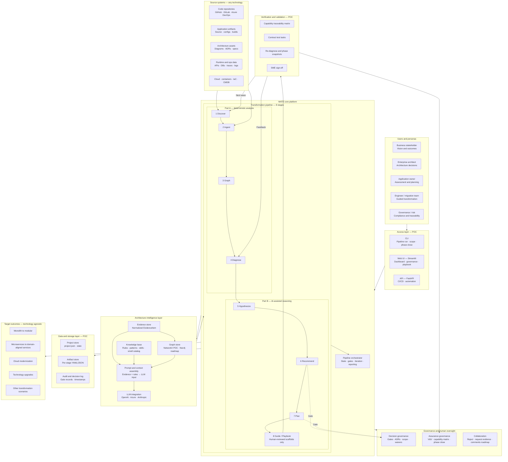
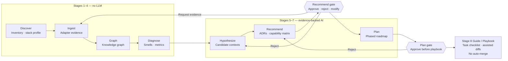
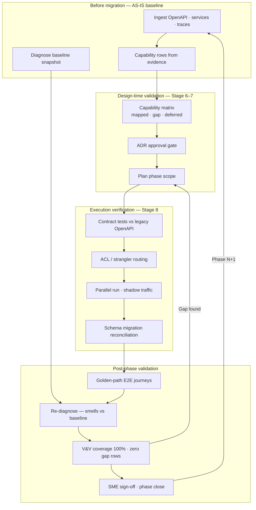
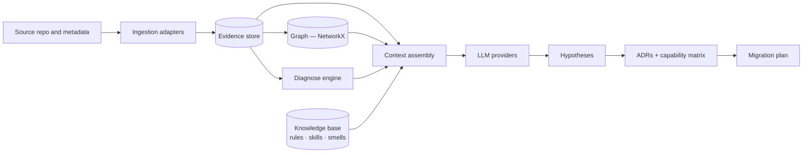

# MATE — Logical Architecture (v2)

**Modernization & Architecture Transformation Engine**

Canonical logical architecture for MATE. Use this document for stakeholder decks, architecture reviews, and drawing-tool exports (Mermaid, draw.io, Lucidchart).

**Related:** [Operating model](operating-model.md) · [Framework methodology](framework-methodology.md) · [Target architecture](target-architecture.md) · [V&V roadmap](friday-roadmap-governance-vv.md)

---

## Legend

| Style | Meaning |
|-------|---------|
| **Solid components** | Implemented in the EuroSA Bank POC (`platform/migrate_framework/`) |
| *Dashed / italic components* | Roadmap — designed in, not fully built |
| **Gate** | Human approval required before advancing |
| **V&V** | Verification (built correctly) + Validation (business capability parity) |

**Stage 8 naming:** The pipeline stage is `playbook` in code and CLI. **Guide** is the stakeholder-facing label for the same stage — assisted execution, not autonomous transformation.

> **Core rule:** MATE never auto-merges production services. Stage 8 produces playbook tasks and diff-reviewed scaffolds; engineers execute and validate.

---

## 1. Platform overview

---

## 2. Pipeline and gates (detail)

| Stage | POC module | Repeatable? | LLM? | Human gate? |
|-------|------------|-------------|------|-------------|
| 1 Discover | `ingestion/discover.py` | Yes | No | No |
| 2 Ingest | `ingestion/adapters/*` | Yes | No | Optional |
| 3 Graph | `graph/builder.py` | Yes | No | No |
| 4 Diagnose | `analysis/diagnose.py` | Yes | No | Optional |
| 5 Hypothesize | `analysis/hypothesize.py` | Mock deterministic | Yes | Optional |
| 6 Recommend | `analysis/recommend.py` | Evidence-grounded | Yes | **Required** |
| 7 Plan | `migration/planner.py` | From ADRs + landscape | Partial | **Required** |
| 8 Guide / Playbook | `migration/playbook.py` | Engineer-executed | Optional assist | Diff review |

---

## 3. Verification and validation loop

Answers: *Does TO-BE still serve the same business capabilities as AS-IS?*

**POC artifacts:** `vv/capability_matrix.py` · Governance → V&V panel · Playbook contract-test scaffolds · `pipeline/phase_snapshot.py` readiness score.

---

## 4. Architecture intelligence flow

Shows how evidence becomes constrained AI output (today: JSON context assembly; roadmap: RAG + vector store).

*Roadmap:* Vector store and embeddings between Evidence store and Context assembly for semantic retrieval (RAG).

---

## 5. POC vs roadmap matrix

| Component | POC (today) | Roadmap |
|-----------|-------------|---------|
| **Graph store** | NetworkX in-memory | Neo4j / persistent graph DB |
| **Vector store** | — | Embeddings for RAG |
| **Knowledge base** | `.cursor/rules/`, skills, smell catalog, manifest | Centralized pattern library UI |
| **Runtime ingestion** | Synthetic traces (`metadata/`), `TraceAdapter` | Live APM, logs, CMDB |
| **Cloud / IaC adapters** | — | Terraform, K8s, ARM/Bicep |
| **Collaboration** | Reject, request-evidence, decision log | Threaded comments, evidence requests |
| **Audit store** | `decision_log` in project metadata | Immutable enterprise audit service |
| **Multi-LLM synthesis** | Per-provider runs in `llm_providers.py` | Orchestrated consensus / voting |
| **Contract tests** | Playbook scaffolds | CI-wired OpenAPI diff runners |
| **.NET adapters** | Registered stubs | Full parity with Java |

---

## 6. Component-to-code mapping

| Diagram box | Repository path |
|-------------|-----------------|
| CLI | `platform/migrate_framework/cli.py` |
| Web UI | `platform/migrate_framework/ui/app.py` |
| API | `platform/migrate_framework/api/main.py` |
| Pipeline orchestrator | `platform/migrate_framework/pipeline/orchestrator.py` |
| Ingestion adapters | `platform/migrate_framework/ingestion/adapters/` |
| Graph builder | `platform/migrate_framework/graph/builder.py` |
| Diagnose | `platform/migrate_framework/analysis/diagnose.py` |
| Hypothesize / LLM | `platform/migrate_framework/analysis/hypothesize.py`, `llm_providers.py` |
| Recommend | `platform/migrate_framework/analysis/recommend.py` |
| Plan | `platform/migrate_framework/migration/planner.py` |
| Guide / Playbook | `platform/migrate_framework/migration/playbook.py`, `task_assistant.py` |
| Decision governance | `platform/migrate_framework/pipeline/governance.py`, `scope.py` |
| Capability matrix (V&V) | `platform/migrate_framework/vv/capability_matrix.py` |
| Phase snapshots | `platform/migrate_framework/pipeline/phase_snapshot.py` |
| Project / artifact store | `platform/migrate_framework/pipeline/project_store.py` |

---

## 7. Box labels for drawing tools

Copy into ChatGPT, draw.io, Lucidchart, or PowerPoint. Group boxes left-to-right as in section 1.

### Row 1 — Personas
- Business Stakeholder — Vision & Outcomes
- Enterprise Architect — Architecture Decisions
- Application Owner — Assessment & Planning
- Engineer / Migration Team — Guided Transformation
- Governance / Risk — Compliance & Traceability

### Row 2 — Access layer `[POC]`
- **CLI** — Pipeline execution, batch scope, phase close, CI scripts
- **Web UI (Streamlit)** — Dashboard, governance, AS-IS→TO-BE, playbook, assessment report
- **API (FastAPI)** — Projects, run stage, approve/reject, status

### Row 3 — Source systems `[mixed]`
- Code Repositories — GitHub, GitLab, Azure DevOps, Bitbucket `[POC: local path]`
- Application Artifacts — Source, binaries, configs, builds `[POC]`
- Architecture Assets — Diagrams, ADRs, specifications `[POC: manifest + metadata]`
- Runtime & Ops Data — APIs, databases, traces, logs `[POC: synthetic; roadmap: live]`
- Cloud / IaC / CMDB `[roadmap]`

### Row 4 — MATE core — Pipeline `[POC]`

**Part A — Deterministic analysis (establish architectural facts)**
1. Discover — Analyze and identify artifacts
2. Ingest — Extract and normalize evidence
3. Graph — Build architecture knowledge graph
4. Diagnose — Detect smells and health metrics

**Part B — AI-assisted reasoning (generate options and guidance)**
5. Hypothesize — Candidate transformation options
6. Recommend — Prioritize target architecture + **capability matrix**
7. Plan — Phased migration roadmap
8. Guide / Playbook — Execution tasks; **assisted scaffolds with diff review; no auto-merge**

**Orchestrator** — State, workflow, human gates, iteration/re-entry, reporting

### Row 5 — Architecture intelligence `[mixed]`
- Evidence Store — Normalized `EvidenceItem` + artifacts `[POC]`
- Graph Store — NetworkX `[POC]` → Neo4j `[roadmap]`
- Knowledge Base — Rules, patterns, principles, skills `[POC: repo files]`
- Prompt & Context Assembly — Evidence + rules → LLM input `[POC]`; RAG guardrails `[roadmap]`
- LLM Integration — OpenAI, Azure, Anthropic `[POC]`

### Row 6 — Governance `[mixed]`
- **Decision governance** — Approval workflows, ADRs, scope, phase management, waivers `[POC]`
- **Assurance governance** — V&V, capability matrix review, phase close, readiness score `[POC]`
- Policy & compliance — Standards, security, risk `[roadmap]`
- Collaboration — Comments, evidence requests `[partial POC]`

### Row 7 — V&V `[POC]`
- Capability traceability matrix (AS-IS API → TO-BE context)
- Contract tests (legacy OpenAPI pin)
- Re-diagnose and phase snapshots
- SME sign-off before phase close

### Row 8 — Data and storage `[POC]`
- Project Store — State, configuration, progress
- Artifact Store — Reports, plans, playbooks per stage
- Graph Database — In-memory graph (Neo4j roadmap)
- Vector Store — `[roadmap]`
- Audit & Log Store — Gate decisions, timestamps (immutable store roadmap)

### Row 9 — Target outcomes
- Monolith → Modular
- Monolith + Frontend → Services
- Microservices → Domain-aligned services
- Cloud Modernization
- Technology Upgrades
- Other transformation scenarios

### Connectors (important arrows)
- Source systems → Discover + Ingest
- Stages 6 & 7 → **Gate** → Decision governance
- Stage 8 → V&V → Assurance governance
- V&V failure → re-Plan or re-Diagnose (feedback loop)
- Phase close → next wave → Discover (incremental transformation)

---

## 8. Changes from diagram v1 (ChatGPT)

| v1 issue | v2 resolution |
|----------|----------------|
| Neo4j shown as current | Labeled NetworkX POC; Neo4j roadmap |
| No V&V layer | Dedicated V&V subgraph + section 3 loop |
| Stage 8 implied automation | Explicit “no auto-merge” on Stage 8 box |
| CLI missing from access | CLI alongside Streamlit and FastAPI |
| Intelligence layer as four silos | Section 4 shows evidence → graph → context → LLM chain |
| Governance monolithic | Split decision vs assurance governance |
| No POC honesty | Legend + section 5 matrix throughout |

---

## 9. Export notes

- **Mermaid:** Sections 1–4 render in GitHub, VS Code, and most markdown viewers.
- **Stakeholder deck:** Export section 1 as PNG; add legend slide from section “Legend”.
- **ARB pack:** Include sections 3 (V&V), 5 (POC vs roadmap), and 6 (code mapping).
